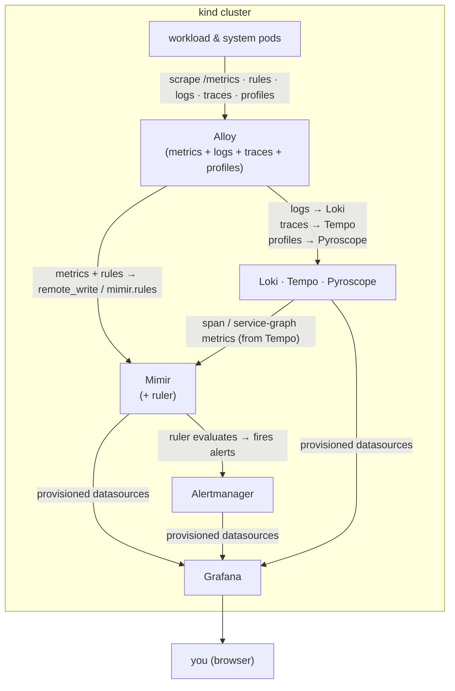

# Observability Demo

A minimal, reproducible demo of the full Grafana observability stack running on a
local [kind](https://kind.sigs.k8s.io/) cluster. A single **Grafana Alloy**
collector gathers **all four signals** - metrics, logs, traces, and profiles -
and ships them to the storage backends: **Mimir** (metrics), **Loki** (logs),
**Tempo** (traces), and **Pyroscope** (profiles). Everything is read back through
**Grafana** (the **L**oki / **G**rafana / **T**empo / **M**imir stack, plus
Pyroscope), and **Headlamp** provides a web UI for browsing the cluster itself.

Alloy reads the Prometheus-Operator CRDs directly to scrape metrics and
remote-write them to Mimir, and syncs alerting rules into Mimir's **ruler**,
which evaluates them against **Alertmanager**. **kube-prometheus-stack** provides
the Operator, kube-state-metrics, node-exporter, and Alertmanager;
**Grafana Alerting** shows what's firing.

The web UIs are exposed as NodePort services and published on the host via kind
`extraPortMappings`, so they're reachable directly on `localhost` (e.g. Grafana
at `http://localhost:3000`, Headlamp at `http://localhost:4466`).

>[!NOTE]
>
>*Grafana at `http://localhost:3000`, rendering a stock Kubernetes dashboard from metrics scraped by Alloy and stored in Mimir - one of the many views this stack lights up.*



## Prerequisites

`make`, `podman`, `kind`, `kubectl`, `helm`, and `python3` on your PATH.
Once `make` is available, run `make check-tools` to verify the rest.

This setup uses **Podman** as the container runtime. The Makefile exports
`KIND_EXPERIMENTAL_PROVIDER=podman` for you, so `kind` uses Podman automatically.

Grafana's AI assistant talks to an Azure AI Foundry endpoint by default, so set
`AZURE_LLM_API_KEY` in `.env` (gitignored) before `make up` if you want it
working - see [AI assistant, in Grafana](#what-gets-deployed) below.

## Quick start

```bash
make up      # create cluster + deploy the stack + Alloy + validate + demo app
make down    # delete the cluster
```

>[!TIP]
>Run `make help` to see every target.

## What gets deployed

Everything lands in the `observability` namespace and is installed via Helm with
locally controlled values files under [`helm/`](helm/).

| Component | Chart | Version | Role | Storage |
|-----------|-------|---------|------|---------|
| kube-prometheus-stack | `prometheus-community/kube-prometheus-stack` | 87.5.1 | Prometheus Operator + kube-state-metrics + node-exporter + Alertmanager (Grafana & Windows exporter disabled) | ephemeral |
| metrics-server | `metrics-server/metrics-server` | 3.13.1 | kubelet resource metrics (`kubectl top`/HPA), scraped via its built-in ServiceMonitor | - |
| Mimir     | `grafana/mimir-distributed` | 6.1.0 | metrics storage; ruler evaluates alerting rules | bundled MinIO |
| Loki      | `grafana/loki`   | 7.0.0  | logs storage (SingleBinary) | filesystem |
| Tempo     | `grafana-community/tempo`  | 2.2.3 | traces storage (single binary) | filesystem |
| Pyroscope | `grafana/pyroscope` | 2.1.0 | profiles storage (monolithic `all` target) | filesystem |
| Grafana Operator | `grafana/grafana-operator` | 5.24.0 | reconciles `helm/grafana`'s CRDs into a running Grafana | - |
| Grafana   | `helm/grafana` (first-party CRs: `Grafana`, `GrafanaDatasource`) | operator-managed | provisioned datasources + Kubernetes dashboards; installs the `grafana-llm-app` + Graft AI plugins (backed by Azure AI Foundry) | ephemeral |
| Alloy     | `grafana/alloy`  | 1.10.0 | DaemonSet collector for metrics, logs, traces, profiles, and alerting rules | - |
| Headlamp  | `headlamp/headlamp` | 0.43.0 | in-cluster dashboard (cluster-admin, no-login demo mode) | - |

>[!NOTE]
>Grafana Operator + Grafana are deployed only in the default
>`DASHBOARD_BACKEND=grafana` mode. An opt-in `DASHBOARD_BACKEND=perses` mode
>swaps them for the Perses Operator + Perses instead (no LLM/Graft/Ollama) -
>see [docs/dashboard-backends.md](docs/dashboard-backends.md).

Alongside the stack, `make up` also builds and deploys the **OpenTelemetry demo
app** (`otel-demo-app`) into its own `otel-demo` namespace - via plain
Kubernetes manifests rather than Helm. See [Demo application](#demo-application)
below.

**AI assistant, in Grafana.** `make up` also wires up an in-Grafana AI
assistant. The Grafana chart installs two plugins
([`helm/grafana/values.yaml`](helm/grafana/values.yaml)): the official
`grafana-llm-app` (pointed at an **Azure AI Foundry** endpoint via its
OpenAI-compatible API - set `AZURE_LLM_API_KEY` in `.env`) and
[**Graft**](https://github.com/vikshana/vikshana-graft-app), a community "AI
Assistant for Grafana" app that layers a natural-language chat UI on top of
it, using Grafana's built-in MCP tools to query your dashboards, metrics,
logs, traces, and alerts. Find **Graft** in the Grafana nav at
`http://localhost:3000`. An opt-in mode swaps in a local, key-less
[Ollama](docs/solutions/ollama.md) backend instead - see
[docs/llm-backends.md](docs/llm-backends.md). See
[Learn the tools](#learn-the-tools) below for the full guides.

## Exposing the UIs (NodePort + extraPortMappings)

The web UIs are `type: NodePort` services on fixed node ports, and the
kind node publishes those ports on the host via `extraPortMappings`:

| UI            | Service nodePort | Host URL |
|---------------|------------------|----------|
| Grafana       | 30000            | http://localhost:3000  |
| Alloy         | 30345            | http://localhost:12345 |
| Alertmanager  | 30093            | http://localhost:9093  |
| Headlamp      | 30466            | http://localhost:4466  |
| Otel-Demo-App | 30080            | http://localhost:8080  |

The node ports in [`helm/grafana/values.yaml`](helm/grafana/values.yaml),
[`helm/alloy/values.yaml`](helm/alloy/values.yaml),
[`helm/kube-prometheus-stack/values.yaml`](helm/kube-prometheus-stack/values.yaml)
(Alertmanager's), and [`helm/headlamp/values.yaml`](helm/headlamp/values.yaml)
must match the `extraPortMappings` in [`kind/cluster.yaml`](kind/cluster.yaml).
Because those mappings are applied at cluster-creation time, **changing them
requires `make down && make up`**. Alloy's OTLP receiver ports (4317/4318) stay
cluster-internal - demo apps push to them via the in-cluster Service DNS.

## Layout

```
.
├── Makefile                       # orchestration (cluster, deploy, validate, teardown)
├── kind/cluster.yaml              # single-node kind cluster + UI port mappings
├── helm/<component>/values.yaml   # per-component Helm values (source of truth)
├── apps/otel-demo/                # OTel-instrumented demo app (own namespace)
├── scripts/
│   ├── lib.sh                     # shared shell helpers
│   ├── validate.sh                # pods Ready + datasource health + UI reachability
│   └── demo-test.sh               # verify the demo app emits all four signals
└── docs/
    ├── architecture.md            # deeper design notes (the "why")
    ├── otel-instrumentation.md    # how the demo app is OTel-instrumented
    ├── correlation.md             # how the four signals link to each other
    ├── metrics-modes.md           # an alternate metrics-collection mode for testing
    ├── llm-backends.md            # an alternate AI-assistant model backend for testing
    ├── dashboard-backends.md      # an alternate dashboard backend (Perses) for testing
    └── solutions/                 # per-tool intro guides (start here to learn each tool)
```

## Learn the tools

New to the Grafana observability stack? [`docs/solutions/`](docs/solutions/) has a
short, beginner-friendly guide to each tool in this demo - what it is, what it's
for, and how it's wired in here:

- [Kube-Prometheus-Stack](docs/solutions/kube-prometheus-stack.md) - operator, exporters, Alertmanager
- [Mimir](docs/solutions/mimir.md) - long-term metrics storage + rule evaluation (ruler)
- [Loki](docs/solutions/loki.md) - logs storage
- [Tempo](docs/solutions/tempo.md) - traces storage
- [Pyroscope](docs/solutions/pyroscope.md) - continuous profiling
- [Alloy](docs/solutions/alloy.md) - the collection pipeline (all four signals)
- [Headlamp](docs/solutions/headlamp.md) - cluster UI
- [Kind & Podman](docs/solutions/kind-and-podman.md) - the local platform
- [Perses](docs/solutions/perses.md) - opt-in Grafana alternative

## Demo application

An OpenTelemetry-instrumented demo app ships in
[`apps/otel-demo/`](apps/otel-demo/). It's a small Go microservices app -
`frontend → {checkout → payment, catalog}` - that generates **all four
signals** and feeds them into **this stack's own collectors** (no bundled
collector/backends, unlike the upstream OpenTelemetry demo). It runs in its own
**`otel-demo`** namespace and requires **no changes to the stack**.

The **frontend serves an interactive web UI at `http://localhost:8080`** where
you place orders and drive load by hand - that's the default. A **`loadgen`** is
included as an *optional* background traffic driver, **off by default**; deploy it
with `DEMO_LOADGEN=true`.

>[!NOTE]
>
>*The demo app's traffic console - place orders or flip on *Auto load* to generate the traces, metrics, logs, and profiles you then explore in Grafana.*

| Signal   | App emits | Stack collects |
|----------|-----------|----------------|
| Traces   | OTLP/gRPC → Alloy | Alloy → Tempo |
| Metrics  | `/metrics` (OTel Prometheus exporter) + `PodMonitor` | Alloy → remote_write → Mimir |
| Logs     | `slog` JSON to stdout with a `trace_id` field | Alloy pod-log tail → Loki (auto-linked to traces) |
| Profiles | Go `pprof` + `pyroscope.io/scrape` annotation | Alloy → Pyroscope |

```bash
make demo                      # build images, load into kind, deploy the app (no loadgen)
make demo DEMO_LOADGEN=true    # also deploy the background loadgen
make demo-ui                   # print the web UI URL (http://localhost:8080)
make demo-test                 # assert all four signals are flowing end to end
make demo-clean                # remove the demo (delete its namespace)
```

Open the **web UI at `http://localhost:8080`** to place orders and drive load,
then open Grafana (`http://localhost:3000`, admin/admin) and:

- **Explore → Tempo**: search `service.name=frontend`; open a trace spanning
  frontend → checkout → payment / catalog, and view the service graph. From a
  span, follow the pre-wired links to logs, metrics, and profiles.
- **Explore → Loki**: `{namespace="otel-demo"}`; click a line's `trace_id` to jump
  to its Tempo trace.
- **Explore → Mimir**: query `demo_orders_total` or
  `http_server_request_duration_seconds_bucket`; turn on **Exemplars** and click
  a dot to jump to the trace behind that sample.
- **Explore → Pyroscope**: flame graph for the `payment` service shows the CPU
  hot path - or get there from a `payment` span, which carries an embedded flame
  graph for that single request.

>[!TIP]
>Those "pre-wired links" are the point of the whole stack: every signal reaches
>every other one, including per-span flame graphs and metric exemplars. What
>joins each pair - and the one direction that still isn't joined - is documented
>in [docs/correlation.md](docs/correlation.md).

>[!NOTE]
>
>*The payoff of a correlated stack: from a `frontend → checkout → payment / catalog` trace in Tempo (left), one click on `Logs for this span` lands on the exact log line in Loki (right), joined by `trace_id`.*

See [`apps/otel-demo/README.md`](apps/otel-demo/README.md) for the instrumentation
walkthrough.

## Advanced

The demo collects metrics with Alloy by default. For an alternate
metrics-collection mode intended for specific testing scenarios - running
kube-prometheus-stack's own Prometheus server in the loop - see
[docs/metrics-modes.md](docs/metrics-modes.md).

Grafana's AI assistant talks to Azure AI Foundry by default. For an alternate,
key-less model backend intended for specific testing scenarios - running
Ollama in-cluster instead - see [docs/llm-backends.md](docs/llm-backends.md).

The demo visualizes everything through Grafana by default. For an alternate
dashboard backend intended for specific testing scenarios - running
[Perses](docs/solutions/perses.md) instead - see
[docs/dashboard-backends.md](docs/dashboard-backends.md).
