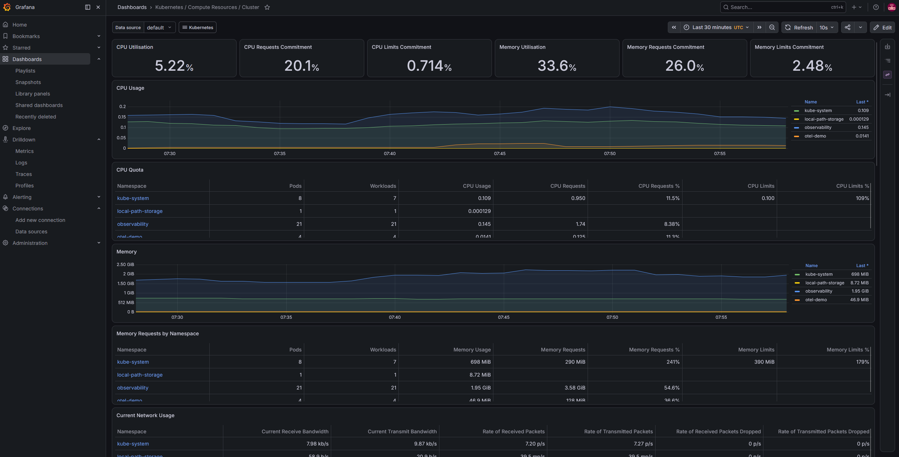
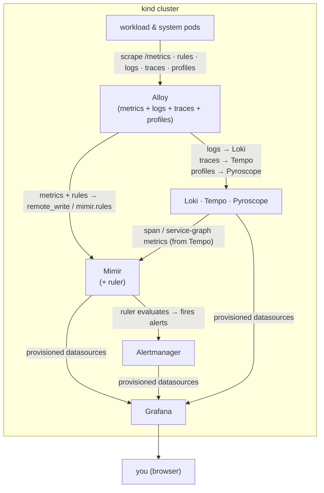
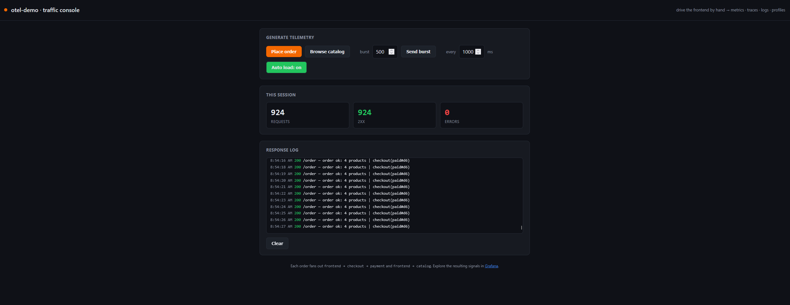
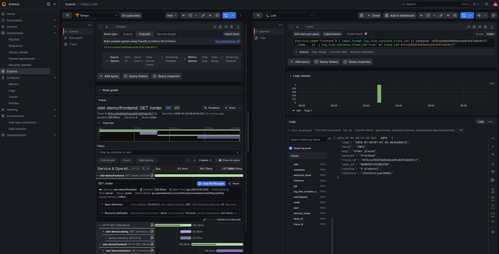

# Observability Demo

A minimal, reproducible demo of the full Grafana observability stack running on a
local [kind](https://kind.sigs.k8s.io/) cluster. Metrics collection has **two
toggleable modes** (`METRICS_MODE`, default `alloy`):

- **`alloy` (default)**: **Grafana Alloy** collects *all four signals* — it reads
  the Prometheus-Operator CRDs directly, scrapes **metrics** and remote-writes
  them to **Mimir**, and syncs alerting rules into Mimir's **ruler**, which
  evaluates them against Alertmanager. **kube-prometheus-stack** deploys only
  the Operator, kube-state-metrics, node-exporter, and Alertmanager (no
  Prometheus server), and **Karma is not deployed** — Grafana Alerting (via the
  Mimir datasource) covers that role instead.
- **`prometheus`** (`make up METRICS_MODE=prometheus`): the original setup —
  **kube-prometheus-stack**'s own Prometheus scrapes metrics via ServiceMonitors,
  evaluates alerting rules itself, and remote-writes to Mimir; **Karma** is
  deployed as Alertmanager's dashboard.

In both modes, Alloy also collects **logs** and **traces** (always) and
**profiles** (always), shipping them to Loki / Tempo / Pyroscope. Everything is
read back through **Grafana** (**L**oki / **G**rafana / **T**empo / **M**imir,
plus Pyroscope). **Headlamp** provides a web UI for browsing the cluster itself.
The web UIs are exposed as NodePort services and published on the host via kind
`extraPortMappings`, so they're reachable directly on `localhost` (e.g. Grafana
at `http://localhost:3000`, Headlamp at `http://localhost:4466`).

See [architecture.md](docs/architecture.md#metrics-collection--alerting-two-modes)
for the full rationale behind both modes.

>[!NOTE]
>
>*Grafana at `http://localhost:3000`, rendering a stock Kubernetes dashboard from metrics scraped by the collector and stored in Mimir — one of the many views this stack lights up.*



*Default (`METRICS_MODE=alloy`) architecture. In the `METRICS_MODE=prometheus`
toggle, Prometheus (deployed by kube-prometheus-stack) replaces Alloy for the
metrics/rules path, Mimir's ruler is disabled, and Karma is deployed to read
Alertmanager directly — see
[architecture.md](docs/architecture.md#metrics-collection--alerting-two-modes)
for the full breakdown, and [docs/solutions/README.md](docs/solutions/README.md#how-they-fit-together)
for a side-by-side diagram of both modes.*

## Prerequisites

`make`, `podman`, `kind`, `kubectl`, `helm`, and `python3` on your PATH.
Once `make` is available, run `make check-tools` to verify the rest.

This setup uses **Podman** as the container runtime. The Makefile exports
`KIND_EXPERIMENTAL_PROVIDER=podman` for you, so `kind` uses Podman automatically.

## Quick start

```bash
make up                                 # create cluster + deploy stack + Alloy + validate (METRICS_MODE=alloy, default)
make up METRICS_MODE=prometheus         # ...or the original as-is setup (KPS Prometheus + Karma)
make ai                                 # optional: Ollama + kagent (AI agent framework) — not part of `make up`
make down                               # delete the cluster
```

>[!TIP]
>Run `make help` to see every target. `METRICS_MODE` also applies to `make stack`,
>`make kube-prometheus-stack`/`alloy`/`mimir`/`grafana`, and `make validate`.

## What gets deployed

Everything lands in the `observability` namespace and is installed via Helm with
locally controlled values files under [`helm/`](helm/). Rows marked
**(METRICS_MODE=prometheus)** are only deployed in that toggle; rows marked
**(make ai)** are an opt-in extra, not part of `make up`; everything else is
deployed in both metrics modes by `make up`.

| Component | Chart | Version | Mode | Storage |
|-----------|-------|---------|------|---------|
| kube-prometheus-stack | `prometheus-community/kube-prometheus-stack` | 87.5.1 | operator + kube-state-metrics + node-exporter + Alertmanager (Grafana & Windows exporter disabled); + Prometheus itself in **METRICS_MODE=prometheus** | ephemeral (2h local retention, when Prometheus runs) |
| Mimir     | `grafana/mimir-distributed` | 6.1.0 | minimal (1 replica/component, no zones/Kafka); ruler enabled by default | bundled MinIO |
| Loki      | `grafana/loki`   | 7.0.0  | SingleBinary (monolithic) | filesystem |
| Tempo     | `grafana-community/tempo`  | 2.2.3 | single binary (monolithic) | filesystem |
| Pyroscope | `grafana/pyroscope` | 2.1.0 | monolithic (`all` target) | filesystem |
| Grafana Operator | `grafana/grafana-operator` | 5.24.0 | reconciles `helm/grafana`'s CRDs into a running Grafana | — |
| Grafana   | `helm/grafana` (first-party CRs: `Grafana`, `GrafanaDatasource`, `GrafanaServiceAccount`) | operator-managed | provisioned datasources + KPS dashboards via k8s-sidecar | ephemeral |
| Alloy     | `grafana/alloy`  | 1.10.0 | DaemonSet collector — logs/traces/profiles, + metrics & rules by default (**METRICS_MODE=alloy**) | — |
| Headlamp  | `headlamp/headlamp` | 0.43.0 | in-cluster dashboard (cluster-admin, no-login demo mode) | — |
| Karma     | `helm/karma` (first-party) | v0.131 | **(METRICS_MODE=prometheus)** alert dashboard over Alertmanager (reads all alerts) | — |
| Ollama    | `ollama-helm/ollama` | 1.65.0 | **(make ai)** CPU inference, serves the `llama3.1:8b` model | none (re-pulled on pod start) |
| kagent    | `oci://ghcr.io/kagent-dev/kagent/helm/{kagent-crds,kagent}` | 0.9.11 | **(make ai)** runs **ObsAgent**, a custom observability-expert `Agent` CRD (no stock agents enabled); `grafana-mcp` + kagent's k8s/helm/prometheus tools, backed by Ollama + this Grafana, OTel tracing/logging on | bundled Postgres (dev/eval only) |

Alongside the stack, `make up` also builds and deploys the **OpenTelemetry demo
app** (`otel-demo-app`) into its own `otel-demo` namespace — via plain
Kubernetes manifests rather than Helm. See [Demo application](#demo-application)
below.

`make ai` (optional — **not** part of `make up`, since even at this stage
it's the heaviest thing in the repo) deploys **Ollama + kagent**, running
**ObsAgent**: a Kubernetes observability AI agent expert that queries this
stack's own live telemetry (Mimir/Loki/Tempo/Pyroscope via Grafana, plus the
cluster itself) and can act on what it finds. Ollama serves the `llama3.1:8b`
model locally, so no external LLM API key is ever needed. ObsAgent is a
custom `Agent` CRD ([`helm/kagent/obs-agent.yaml`](helm/kagent/obs-agent.yaml))
rather than one of kagent's stock agents, with tools spanning
Kubernetes/Helm/Prometheus (kagent's own tool server) and all of `grafana-mcp`
(dashboards, Mimir, Loki, Pyroscope, alerting, and more). kagent's
traces/logs flow through this stack's own Alloy collector into Tempo and
Loki, same as the demo app. Its web UI is at `http://localhost:8090`
(`make kagent-ui`) via a supplementary NodePort Service
(`helm/kagent/kagent-ui-nodeport.yaml`), since kagent's own chart has no
pinned-nodePort field like this repo's other charts. See
[Learn the tools](#learn-the-tools) below for the full guides.

## Exposing the UIs (NodePort + extraPortMappings)

The web UIs are `type: NodePort` services on fixed node ports, and the 
kind node publishes those ports on the host via `extraPortMappings`:

| UI            | Service nodePort | Host URL | Mode |
|---------------|------------------|----------|------|
| Grafana       | 30000            | http://localhost:3000  | both |
| Alloy         | 30345            | http://localhost:12345 | both |
| Alertmanager  | 30093            | http://localhost:9093  | both |
| Prometheus    | 30090            | http://localhost:9090  | METRICS_MODE=prometheus |
| Karma         | 30081            | http://localhost:8081  | METRICS_MODE=prometheus |
| Headlamp      | 30466            | http://localhost:4466  | both |
| Otel-Demo-App | 30080            | http://localhost:8080  | both |
| kagent        | 30890            | http://localhost:8090  | make ai (optional) |

kind's `extraPortMappings` are static regardless of `METRICS_MODE`, so the
Prometheus/Karma port mappings simply sit idle (nothing listening) in the
default `alloy` mode — no `make down && make up` needed to switch modes.

The node ports in [`helm/grafana/values.yaml`](helm/grafana/values.yaml),
[`helm/alloy/values.yaml`](helm/alloy/values.yaml),
[`helm/kube-prometheus-stack/values-prometheus-metrics.yaml`](helm/kube-prometheus-stack/values-prometheus-metrics.yaml)
(Prometheus's own nodePort only exists in that overlay),
[`helm/kube-prometheus-stack/values.yaml`](helm/kube-prometheus-stack/values.yaml)
(Alertmanager's, in both modes),
[`helm/karma/values.yaml`](helm/karma/values.yaml),
[`helm/headlamp/values.yaml`](helm/headlamp/values.yaml), and
(as a standalone Service rather than a chart value)
[`helm/kagent/kagent-ui-nodeport.yaml`](helm/kagent/kagent-ui-nodeport.yaml)
must match the `extraPortMappings` in [`kind/cluster.yaml`](kind/cluster.yaml).
Because those mappings are applied at cluster-creation time, **changing them
requires `make down && make up`**. Alloy's OTLP receiver ports (4317/4318) stay
cluster-internal — demo apps push to them via the in-cluster Service DNS.

## Layout

```
.
├── Makefile                       # orchestration (cluster, deploy, validate, teardown)
├── kind/cluster.yaml              # single-node kind cluster + UI port mappings
├── helm/<component>/values.yaml   # per-component Helm values (source of truth)
├── apps/otel-demo/                # OTel-instrumented demo app (own namespace)
├── scripts/
│   ├── lib.sh                     # shared shell helpers
│   ├── validate.sh                # pods Ready + datasource health + UI reachability
│   └── demo-test.sh               # verify the demo app emits all four signals
└── docs/
    ├── architecture.md            # deeper design notes (the "why")
    ├── otel-instrumentation.md    # how the demo app is OTel-instrumented
    └── solutions/                 # per-tool intro guides (start here to learn each tool)
```

## Learn the tools

New to the Grafana observability stack? [`docs/solutions/`](docs/solutions/) has a
short, beginner-friendly guide to each tool in this demo — what it is, what it's
for, and how it's wired in here:

- [Kube-Prometheus-Stack](docs/solutions/kube-prometheus-stack.md) — operator, exporters, Alertmanager (+ Prometheus itself in the `METRICS_MODE=prometheus` toggle)
- [Mimir](docs/solutions/mimir.md) — long-term metrics storage + rule evaluation (ruler)
- [Loki](docs/solutions/loki.md) — logs storage
- [Tempo](docs/solutions/tempo.md) — traces storage
- [Pyroscope](docs/solutions/pyroscope.md) — continuous profiling
- [Alloy](docs/solutions/alloy.md) — the collection pipeline (all four signals by default)
- [Karma](docs/solutions/karma.md) — alert dashboard for Alertmanager (`METRICS_MODE=prometheus` toggle only)
- [Headlamp](docs/solutions/headlamp.md) — cluster UI
- [Ollama](docs/solutions/ollama.md) — local LLM inference, serves the `llama3.1:8b` model
- [kagent](docs/solutions/kagent.md) — Kubernetes-native AI agent framework, OTel-instrumented
- [Kind & Podman](docs/solutions/kind-and-podman.md) — the local platform

## Demo application

An OpenTelemetry-instrumented demo app ships in
[`apps/otel-demo/`](apps/otel-demo/). It's a small Go microservices app —
`frontend → {checkout → payment, catalog}` — that generates **all four
signals** and feeds them into **this stack's own collectors** (no bundled
collector/backends, unlike the upstream OpenTelemetry demo). It runs in its own
**`otel-demo`** namespace and requires **no changes to the stack**.

The **frontend serves an interactive web UI at `http://localhost:8080`** where
you place orders and drive load by hand — that's the default. A **`loadgen`** is
included as an *optional* background traffic driver, **off by default**; deploy it
with `DEMO_LOADGEN=true`.

>[!NOTE]
>
>*The demo app's traffic console — place orders or flip on *Auto load* to generate the traces, metrics, logs, and profiles you then explore in Grafana.*

| Signal   | App emits | Stack collects |
|----------|-----------|----------------|
| Traces   | OTLP/gRPC → Alloy | Alloy → Tempo |
| Metrics  | `/metrics` (OTel Prometheus exporter) + `PodMonitor` | Alloy (default) or Prometheus (`METRICS_MODE=prometheus`) → remote_write → Mimir |
| Logs     | `slog` JSON to stdout with a `trace_id` field | Alloy pod-log tail → Loki (auto-linked to traces) |
| Profiles | Go `pprof` + `pyroscope.io/scrape` annotation | Alloy → Pyroscope |

```bash
make demo                      # build images, load into kind, deploy the app (no loadgen)
make demo DEMO_LOADGEN=true    # also deploy the background loadgen
make demo-ui                   # print the web UI URL (http://localhost:8080)
make demo-test                 # assert all four signals are flowing end to end
make demo-clean                # remove the demo (delete its namespace)
```

Open the **web UI at `http://localhost:8080`** to place orders and drive load,
then open Grafana (`http://localhost:3000`, admin/admin) and:

- **Explore → Tempo**: search `service.name=frontend`; open a trace spanning
  frontend → checkout → payment / catalog, and view the service graph. From a
  span, follow the pre-wired links to logs, metrics, and profiles.
- **Explore → Loki**: `{namespace="otel-demo"}`; click a line's `trace_id` to jump
  to its Tempo trace.
- **Explore → Mimir**: query `demo_orders_total` or
  `http_server_request_duration_seconds_count`.
- **Explore → Pyroscope**: flame graph for the `payment` service shows the CPU
  hot path.

>[!NOTE]
>
>*The payoff of a correlated stack: from a `frontend → checkout → payment / catalog` trace in Tempo (left), one click on `Logs for this span` lands on the exact log line in Loki (right), joined by `trace_id`.*

See [`apps/otel-demo/README.md`](apps/otel-demo/README.md) for the instrumentation
walkthrough.
