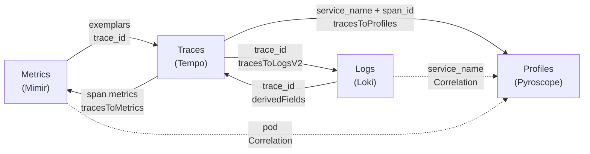

# Cross-signal correlation

Collecting all four signals is the easy half. The half that actually shortens an
incident is being able to move *between* them: from a latency spike to the trace
that caused it, from that trace to the log lines it wrote, and from the same
trace to the flame graph showing which function burned the CPU.

This page documents every jump this stack wires up - what powers it, where it's
configured, and what it deliberately doesn't do.

## The map



Solid arrows are datasource settings; dashed arrows are Grafana **Correlations**
(applied differently - see [below](#logs--profiles-and-metrics--profiles)).

| From | To | Mechanism | Joined on |
|------|----|-----------|-----------|
| Metrics | Traces | Mimir `exemplarTraceIdDestinations` | `trace_id` exemplar on the sample |
| Logs | Traces | Loki `derivedFields` | `trace_id` field in the log line |
| Traces | Logs | Tempo `tracesToLogsV2` | trace ID + `service.name` → `service_name` |
| Traces | Metrics | Tempo `tracesToMetrics` + `serviceMap` | span metrics generated by Tempo |
| Traces | Profiles | Tempo `tracesToProfiles` | `service.name` → `service_name`, plus `span_id` per span |
| Logs | Profiles | Grafana Correlation | `service_name` |
| Metrics | Profiles | Grafana Correlation | `pod` |

Everything except the Correlations lives in
[`helm/grafana/values.yaml`](../helm/grafana/values.yaml), rendered into
`GrafanaDatasource` CRs by
[`templates/datasources.yaml`](../helm/grafana/templates/datasources.yaml).

## Logs ↔ traces

The two directions are separate pieces of config that happen to meet in the
middle at one string: `trace_id`.

**Log → trace** is a Loki **derived field**: a regex over the log line that
extracts a value and turns it into a link. The app logs the active span's trace
ID under `trace_id` (see
[`telemetry.Log`](../apps/otel-demo/internal/telemetry/telemetry.go)), and
Alloy's `loki.process` promotes it to structured metadata under the same name.

**Trace → log** is the Tempo datasource's `tracesToLogsV2`, with
`filterByTraceID: true` so the generated LogQL is scoped to that one trace, and
a ±2s time shift so log lines that land just outside the span's window still
show up. It maps `service.name` → `service_name`, which works because Loki 3.x
derives a `service_name` stream label automatically from the labels Alloy
attaches.

## Metrics → traces (exemplars)

An **exemplar** is a trace ID stapled to a single metric sample: "this
histogram bucket got a hit, and here's one specific request that caused it."
Grafana draws them as dots on the graph, and clicking one opens the trace.

This is the correlation with the most moving parts, because **three independent
things must all be true** and each fails silently on its own:

1. **The app must serve OpenMetrics.** Exemplars have no representation in the
   classic Prometheus text format. The OTel SDK attaches a `trace_id`/`span_id`
   exemplar to every counter add and histogram record automatically, but
   `promhttp.Handler()` throws them away - it defaults to the old format. The
   handler has to be built explicitly with OpenMetrics enabled, which is what
   [`httpx.NewMux`](../apps/otel-demo/internal/httpx/httpx.go) does:

   ```go
   promhttp.HandlerFor(prometheus.DefaultGatherer, promhttp.HandlerOpts{
       EnableOpenMetrics: true,
   })
   ```

2. **Mimir must store them.** Exemplar storage is **off by default**:
   `max_global_exemplars_per_user` defaults to `0`, and a zero means every
   exemplar Alloy forwards is accepted and dropped. The write succeeds, the
   samples land, and only the trace links go missing. It's set to `100000` in
   [`helm/mimir/values.yaml`](../helm/mimir/values.yaml) - an in-memory circular
   buffer per tenant, so a memory budget rather than a retention window.

3. **Grafana must know where to send the ID.** `exemplarTraceIdDestinations`
   maps the *exemplar label* `trace_id` to the Tempo datasource.

Alloy needs no changes: `prometheus.remote_write` has `send_exemplars` on by
default.

>[!TIP]
>`make demo-test` asserts Mimir actually holds `trace_id` exemplars, which is
>the cheapest way to catch any one of those three regressing.

## Traces → profiles

This is the jump that turns "checkout is slow" into "*this function* is slow."
It works at two levels of precision, and this stack wires up both.

### Service-scoped: the tag mapping

From any span, Grafana can open the Pyroscope flame graph for that span's
service over that span's time window. It assembles the query from the
`tracesToProfiles` block:

```yaml
tracesToProfiles:
  datasourceUid: pyroscope
  profileTypeId: process_cpu:cpu:nanoseconds:cpu:nanoseconds
  tags:
    - key: service.name
      value: service_name
```

- **`profileTypeId`** picks *which* profile. `process_cpu` is the delta CPU
  profile Alloy scrapes from `/debug/pprof/profile`. This field is **required**,
  not cosmetic - leave it out and Grafana has no valid query to run, so the link
  resolves to an empty panel.
- **`tags`** maps span attributes onto Pyroscope label names, producing the
  selector `{service_name="payment"}`.
- **The time range** is not configurable: Grafana always queries *span start
  −60s* to *span end +60s*. That padding is load-bearing. Alloy scrapes pprof
  every 15 seconds, so a millisecond-long span would otherwise fall cleanly
  between two profile samples.

#### The label contract

The `tags` remap exists because the two ends name the same service differently:

| | Name | Set by |
|---|------|--------|
| Span attribute | `service.name` | the app, in [`telemetry.Init`](../apps/otel-demo/internal/telemetry/telemetry.go) |
| Pyroscope label | `service_name` | Alloy, from the **container name** ([`discovery.relabel "profiles_pods"`](../helm/alloy/values.yaml)) |

OpenTelemetry attribute keys use dots; Pyroscope label names can't contain them.
So `tags` does the translation - the same trick `tracesToLogsV2` uses for Loki.

But renaming the *key* only helps if the *values* match, and that's a convention
this repo maintains by hand: **each demo container is named after the service it
runs**, so `containers[0].name: payment` produces `service_name="payment"`,
matching `telemetry.Init(ctx, "payment")`.

>[!IMPORTANT]
>Rename a container without renaming its service (or vice versa) and nothing
>breaks loudly - profiles keep flowing, traces keep flowing, and only the link
>between them silently returns an empty flame graph.

### Span-scoped: the embedded flame graph

The better version: Grafana renders a flame graph **inside the span detail**
showing only the CPU burned by *that exact span*. It appears when a span carries
a `pyroscope.profile.id` attribute.

The demo gets this from
[`otel-profiling-go`](https://github.com/grafana/otel-profiling-go), one line in
[`telemetry.Init`](../apps/otel-demo/internal/telemetry/telemetry.go):

```go
otel.SetTracerProvider(otelpyroscope.NewTracerProvider(tp))
```

**This needs no Pyroscope SDK and no push.** That's the part worth knowing: the
wrapper only calls `runtime/pprof.SetGoroutineLabels`, tagging the Go runtime's
own profile with `span_id`, `trace_id` and `span_name`. Those labels ride along
in the CPU profile Alloy already scrapes, so the app still pushes nothing and
still names no backend. (The upstream README suggests pairing it with
`pyroscope.Start()`; that's one way to have a profiler running, not a
requirement. Go's `net/http/pprof` already is one.)

Two details that are easy to get wrong:

**Only the local root span gets the attribute.** By default the wrapper records
`span_id` for the first span created in each process, and child spans' samples
roll up into it. So in a `frontend → checkout → payment` trace, each service
contributes exactly one span with an embedded flame graph, not one per span.
That's a deliberate cardinality trade-off, adjustable via
`WithSpanIDLabelScope(ScopeAllSpans)`.

**`span_id` is not a Pyroscope label - and shouldn't be.** Pyroscope
[explicitly excludes](https://github.com/grafana/pyroscope/blob/main/pkg/model/pprofsplit/pprof_split.go)
`span_id` and `trace_id` when grouping samples into series, because one series
per request would be a cardinality disaster. It keeps them as per-sample labels
and builds a **span index**, queried through a dedicated
`SelectMergeSpanProfile` API. So a `span_id` that's missing from
`LabelNames` is working as designed; the span-selector query is the real test,
and that's what `make demo-test` exercises.

#### Spans need enough CPU to be sampled

Go's CPU profiler samples at 100 Hz. A span that burns less than one 10ms
interval will usually collect **zero** samples, and its embedded flame graph
comes back empty even though every piece of config is correct - the request
simply finished between two samples.

This is why `payment`'s hashing loop is sized the way it is. At the original
`burnCPU(15000)` (~1.8ms per request) the service-level flame graph looked fine
but per-span profiles almost never populated. It now defaults to `200000`
(~25ms), which measured a **49/50** hit rate on individual spans. Tune it with
`PAYMENT_BURN_ITERATIONS`.

## Logs → profiles, and metrics → profiles

Loki and Prometheus datasources have no "link to profiles" setting - only Tempo
does. These jumps are expressed as Grafana
[**Correlations**](https://grafana.com/docs/grafana/latest/administration/correlations/)
instead, declared in `helm/grafana/values.yaml`.

The rule that governs both of them, and which is easy to get wrong:

>[!IMPORTANT]
>`config.field` must be the name of an **actual field on the source data
>frame**, and every `${variable}` in the target query must resolve. Grafana
>matches with `correlation.config.field === field.name` and then drops any link
>where `allVariablesDefined` is false. Both failures look identical from the
>UI - no link, no warning, no error in any log.

### Logs → profiles

A Loki log frame has exactly six fields: `labels`, `Time`, `Line`, `tsNs`,
`labelTypes`, `id`. Stream labels such as `service_name` live *inside* the
`labels` map, so they are not fields and cannot be used for `field` or as
`${service_name}`. (Grafana does inject stream labels as variables, but only for
frames tagged as dataplane log frames; the ones here aren't.)

So the correlation attaches to `Line` - which is also where you'd want to click
- and pulls the service name out of the line itself with a **regex
transformation**:

```yaml
- sourceUID: loki
  targetUID: pyroscope
  label: Profiles for this service
  config:
    field: Line
    transformations:
      - type: regex
        expression: '"service":"([^"]+)"'
        mapValue: service
    target:
      queryType: profile
      profileTypeId: process_cpu:cpu:nanoseconds:cpu:nanoseconds
      labelSelector: '{service_name="${service}"}'
```

`mapValue` binds capture group 1 to `${service}`. This works because the app's
slog handler stamps `"service":"payment"` into every line
(`telemetry.Init`'s `.With("service", ...)`) - the same "the app's output *is*
the join key" pattern as `trace_id`.

`transformations[].field` is deliberately omitted so the transformation reads
whichever field the correlation is attached to. Grafana rewrites `Line` to the
body field name on dataplane frames, and omitting it means the transformation
follows that rename instead of breaking.

### Metrics → profiles

Joined on **`pod`**: a label both sides carry verbatim, which pins the flame
graph to the single replica whose metric you clicked instead of averaging the
service.

>[!NOTE]
>**This link only appears in Explore's Table view.** A Prometheus range query
>returns a time-series frame whose only fields are `Time` and the metric name -
>labels hang off the value field rather than being fields of their own, and the
>label-as-variable injection above applies to log frames only. The table format
>is what pivots each label into its own column and so gives `pod` something to
>attach to; Grafana's correlation code special-cases that frame's
>`rawPrometheus` visualisation type for precisely this. Run the query as
>**instant + Table** to use it.
>
>In the graph view, the equivalent route is metrics → traces (exemplars) →
>profiles: one more hop, no view switch.

### Why these need a Job

This is the one place the stack's "everything is a CR" model doesn't reach.

Grafana only provisions correlations as a `correlations:` block **inside a
datasource provisioning file**, and there is no
`/etc/grafana/provisioning/correlations` directory to drop a standalone file
into (verified against the running container). This stack provisions datasources
as `GrafanaDatasource` CRs, and the Operator's `GrafanaDatasourceInternal` type
has no `correlations` field - with no escape hatch, since `jsonData` and
`secureJsonData` are its only pass-through fields.

Writing a datasources provisioning file just to carry correlations would put a
second writer on datasources the Operator already manages through the same API.
So [`templates/correlations.yaml`](../helm/grafana/templates/correlations.yaml)
applies them through Grafana's **Correlations HTTP API** from a
post-install/post-upgrade Helm hook Job, and datasources stay 100%
Operator-managed.

The Job:

- **Waits for Grafana and for every referenced datasource.** The Grafana
  Deployment doesn't exist yet when Helm applies the release (the Operator
  creates it asynchronously), and a correlation pointing at a datasource that
  hasn't landed is rejected.
- **Reconciles by `(sourceUID, label)`** - it removes the correlation it's about
  to write, then writes it. Re-running `make grafana` converges instead of
  duplicating, and correlations made by hand in the UI are left alone.
- **Reuses the k8s-sidecar image**, purely because it's python3-based and
  already pulled for the Grafana pod. Nothing sidecar-specific is used.

>[!NOTE]
>Correlations applied this way show as `provisioned: false` in Grafana, so
>they're editable in the UI - but a `make grafana` will reset the ones it
>manages.

## What isn't wired, and why

**Profiles → traces.** There's no reverse link. The Pyroscope datasource has no
"profiles to traces" setting to configure. The `trace_id` pprof label is
ingested and indexed, so the data to support it exists - Grafana just doesn't
expose a way to navigate that direction today. Span profiles are the closest
thing: they make a flame graph span-attributable from the trace side.

**Non-CPU span profiles.** `otel-profiling-go` only annotates CPU profiles.
Allocation and goroutine profiles still reach Pyroscope and are still browsable
per service; they just can't be scoped to a span.

**Exemplars on non-app metrics.** Only the demo app's own metrics carry
exemplars. kube-state-metrics, node-exporter and friends have no trace context
to attach - nothing to fix, just don't expect dots on those graphs.

## Try it

With the stack up (`make up`) and some traffic driven from
`http://localhost:8080`:

1. **Metrics → traces.** Explore → Mimir, query
   `http_server_request_duration_seconds_bucket`, and turn on **Exemplars**.
   Click a dot to land in the trace.
2. **Trace → logs.** In that trace, expand a span and follow *Logs for this
   span* to the exact log line, joined by `trace_id`.
3. **Trace → profiles.** On the `payment` service's root span (`GET /pay`), the
   span detail shows an embedded flame graph for that request - the `burnCPU`
   hashing frame is the hot path. *Profiles for this span* opens the
   service-scoped view.
4. **Logs → profiles.** Explore → Loki, `{namespace="otel-demo"}`, expand a log
   row and use the **Profiles for this service** link in its details.
5. **Metrics → profiles.** Explore → Mimir, query `demo_orders_total`, switch
   the query to **instant** and the panel to **Table**, then use **Profiles for
   this pod** on the `pod` column. (In graph view, use the exemplar dots and go
   via the trace instead.)

## Learn more

- [Trace to profiles](https://grafana.com/docs/grafana/latest/datasources/tempo/configure-tempo-data-source/configure-trace-to-profiles/) - the Grafana setting reference
- [Span profiles](https://grafana.com/docs/pyroscope/latest/configure-client/trace-span-profiles/go-span-profiles/) - the Pyroscope side
- [Correlations](https://grafana.com/docs/grafana/latest/administration/correlations/) - Grafana's general-purpose signal linking
- [Exemplars](https://grafana.com/docs/grafana/latest/fundamentals/exemplars/) - what they are and how Grafana renders them
