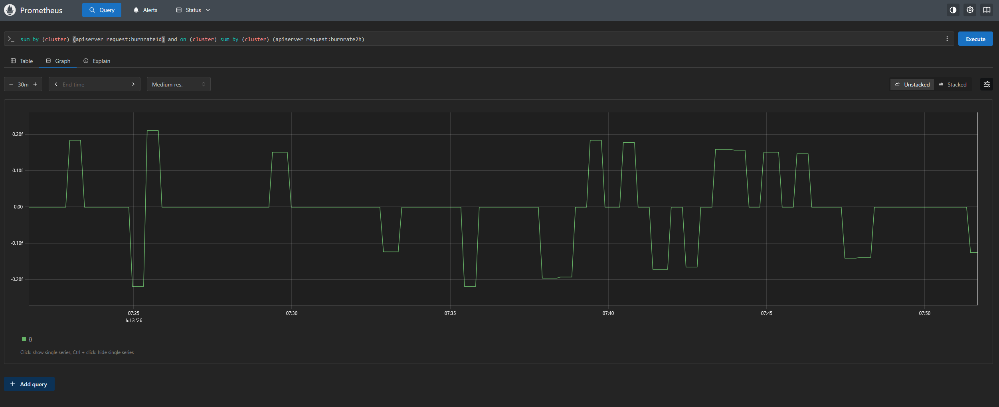

# Metrics collection: the Prometheus testing mode

> **This is an advanced, opt-in option for specific testing scenarios.**
> The default setup collects metrics with Grafana Alloy, and every other
> document in this repo describes that default. Reach for the mode below only
> when you specifically need kube-prometheus-stack's own Prometheus server in
> the loop.

## The default (no flag needed)

`make up` runs the demo with **Alloy** as the single collector for all four
signals. For metrics and alerting that means:

- Alloy reads the Prometheus-Operator CRDs (`ServiceMonitor` / `PodMonitor`)
  directly, scrapes their targets, and remote-writes samples to **Mimir**.
- Alloy syncs `PrometheusRule` objects into **Mimir's ruler**, which evaluates
  them and fires alerts to **Alertmanager**.
- **Grafana Alerting** (via the Mimir datasource) and the Alertmanager UI at
  `http://localhost:9093` show what's firing.

kube-prometheus-stack deploys only the Prometheus **Operator**,
kube-state-metrics, node-exporter, and Alertmanager - no Prometheus server. See
[architecture.md](architecture.md) for the full design.

## The `METRICS_MODE=prometheus` testing mode

Set `METRICS_MODE=prometheus` to run metrics collection through
kube-prometheus-stack's own **Prometheus server** instead of Alloy. This is
useful when you want to test or demonstrate the classic Prometheus scrape-and-
evaluate path, compare behaviour against the Alloy pipeline, or exercise Karma
as an Alertmanager dashboard.

```bash
make up METRICS_MODE=prometheus     # bring the whole stack up in this mode
```

`METRICS_MODE` also applies to `make stack`, the individual
`make kube-prometheus-stack` / `alloy` / `mimir` / `grafana` targets, and
`make validate`.

Everything else about the demo - Loki, Tempo, Pyroscope, the Grafana panels, the
otel-demo app, logs, traces, and profiles - is identical to the default. Only
**how metrics are scraped** and **how alerting rules are evaluated** changes.

### What changes

| | Default (Alloy) | `METRICS_MODE=prometheus` |
|---|---|---|
| Metrics scraping | Alloy reads Operator CRDs, scrapes, remote-writes to Mimir | Prometheus scrapes ServiceMonitors/PodMonitors, remote-writes to Mimir |
| Rule evaluation | Mimir's ruler (Alloy syncs the rules) | Prometheus evaluates `PrometheusRule` objects itself |
| Prometheus server | not deployed | deployed by kube-prometheus-stack |
| Mimir ruler | enabled | disabled |
| Alert dashboard | Grafana Alerting (Mimir datasource) | Karma, plus Grafana Alerting |
| Extra UIs | - | Prometheus `http://localhost:9090`, Karma `http://localhost:8081` |

Under the hood, every affected chart keeps its default `values.yaml` for the
Alloy setup, plus a sibling `values-prometheus-metrics.yaml` overlay that is
applied (via an extra `--values`) only when `METRICS_MODE=prometheus`:

- [`helm/kube-prometheus-stack/values-prometheus-metrics.yaml`](../helm/kube-prometheus-stack/values-prometheus-metrics.yaml)
  enables Prometheus, widens its ServiceMonitor/PodMonitor selectors to every
  namespace, and points its `remoteWrite` at Mimir's gateway (exemplars
  included).
- [`helm/alloy/values-prometheus-metrics.yaml`](../helm/alloy/values-prometheus-metrics.yaml)
  replaces Alloy's config with a logs/traces/profiles-only pipeline (no metrics
  section).
- [`helm/mimir/values-prometheus-metrics.yaml`](../helm/mimir/values-prometheus-metrics.yaml)
  disables Mimir's ruler, since Prometheus evaluates rules itself here.
- [`helm/grafana/values-prometheus-metrics.yaml`](../helm/grafana/values-prometheus-metrics.yaml)
  sets the Mimir datasource's `manageAlerts: false` (the ruler is off).
- `make stack` additionally deploys **Karma** as the Alertmanager dashboard.

With Prometheus in the loop you also get its own query UI at
`http://localhost:9090`:


*Prometheus's own UI at `http://localhost:9090` - a short 2-hour local buffer, queryable with PromQL before samples are remote-written to Mimir. Open **Status → Targets** to watch it discover and scrape every component.*

### Karma, the alert dashboard

In this mode the demo also deploys [Karma](solutions/karma.md), a read-only
dashboard over Alertmanager, at `http://localhost:8081`. In the default setup
Grafana Alerting already covers "what's firing right now," so Karma is left out.

### Switching between modes

kind's `extraPortMappings` are static, so the Prometheus (`9090`) and Karma
(`8081`) host ports are always mapped - they simply sit idle in the default mode
with nothing listening. You can switch modes with `make up METRICS_MODE=...`
without recreating the cluster.
