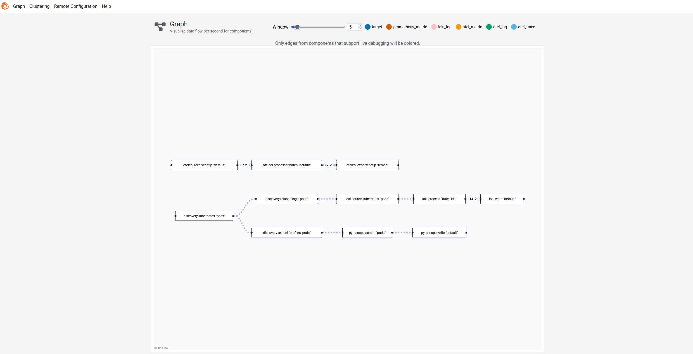

# Alloy

**In one line:** one collector agent that gathers logs, traces, and profiles
(and metrics too) and forwards each to the right backend — the "universal
telemetry pipeline."

> Chart: `grafana/alloy` (v1.10.0, DaemonSet) ·
> config: [`helm/alloy/values.yaml`](../../helm/alloy/values.yaml) ·
> UI: `http://localhost:12345`

## What it is

**Grafana Alloy** is a vendor-neutral **telemetry collector**. Instead of running
a separate agent for each signal, Alloy is one binary that can **receive, scrape,
transform, and route** all of them. It's a distribution of the OpenTelemetry
Collector plus Grafana's own pipeline components, so it speaks both **OTLP** and
the Prometheus/Loki/Pyroscope-native protocols.

You configure it as a **pipeline**: small components wired together, each doing
one step — *discover* targets, *receive* or *scrape* data, *process* it, then
*export* it downstream. The output of one component feeds the input of the next,
like Unix pipes for telemetry.

## Key ideas

- **One agent, many signals.** Logs, traces, profiles (and metrics) through a
  single deployable, instead of a zoo of per-signal agents.
- **Receive *and* scrape.** It can be a push target (apps send OTLP traces to it)
  *and* a puller (it scrapes pod logs and pprof endpoints).
- **Components as a pipeline.** A config is a graph of typed components
  (`otelcol.receiver.otlp`, `loki.source.kubernetes`, `pyroscope.scrape`, …)
  connected explicitly — readable and easy to reason about.
- **Decouples apps from backends.** The app hands telemetry to Alloy; Alloy
  decides where it goes. Swap Loki for another store and no app changes.

## How we use it in this demo

Alloy owns **all four signals** — logs, traces, profiles, *and* metrics +
alerting rules. It runs as a **DaemonSet** — one pod per node — so it's always
local to the workloads it collects from.

| Signal | Alloy pipeline | Sends to |
|--------|----------------|----------|
| Metrics | `prometheus.operator.servicemonitors`/`podmonitors` → `prometheus.remote_write` | [Mimir](./mimir.md) |
| Rules | `mimir.rules.kubernetes` (syncs `PrometheusRule` CRDs) | Mimir's ruler |
| Logs | `discovery.kubernetes` → `loki.source.kubernetes` → `loki.write` | [Loki](./loki.md) |
| Traces | `otelcol.receiver.otlp` → `otelcol.processor.batch` → `otelcol.exporter.otlp` | [Tempo](./tempo.md) |
| Profiles | `discovery.kubernetes` → `pyroscope.scrape` → `pyroscope.write` | [Pyroscope](./pyroscope.md) |

The `prometheus.operator.*` and `mimir.rules.kubernetes` components read the
Prometheus-Operator CRDs (`ServiceMonitor`/`PodMonitor`/`PrometheusRule`)
straight from the Kubernetes API with Alloy's own client — they don't need the
Operator's own reconcile loop, only the CRDs it installs (see
[kube-prometheus-stack](./kube-prometheus-stack.md)). No extra RBAC is needed:
the chart's default ClusterRole already grants the necessary
`get`/`list`/`watch` permissions.

The demo app pushes **traces** to Alloy over OTLP/gRPC, while Alloy **scrapes**
pod logs, `pprof` endpoints, and (by default) metrics on its own. Full config
detail is in [architecture.md](../architecture.md#data-flow).

## Try it

- Open the Alloy UI at `http://localhost:12345` → **Graph** to *see* the live
  pipeline: every component and how data flows between them.
- Click a component to inspect its health, arguments, and throughput.
- Generate traffic in the demo app and watch the receiver/exporter components
  light up.

*The Alloy Graph view — traces (`otelcol.receiver.otlp → batch → exporter.otlp "tempo"`), logs (`discovery → loki.source → loki.process → loki.write`), and profiles (`pyroscope.scrape → pyroscope.write`) as three live pipelines, annotated with per-second throughput.*

## Why it matters

Without a collector, every app would need to know the address and protocol of
every backend — brittle and hard to change. Alloy is the **seam** between "code
that emits telemetry" and "systems that store it": apps stay simple, and you
reconfigure collection and routing centrally, in one place, without redeploying
anything.

## Learn more

- [Grafana Alloy docs](https://grafana.com/docs/alloy/latest/)
- [Component reference](https://grafana.com/docs/alloy/latest/reference/components/)
