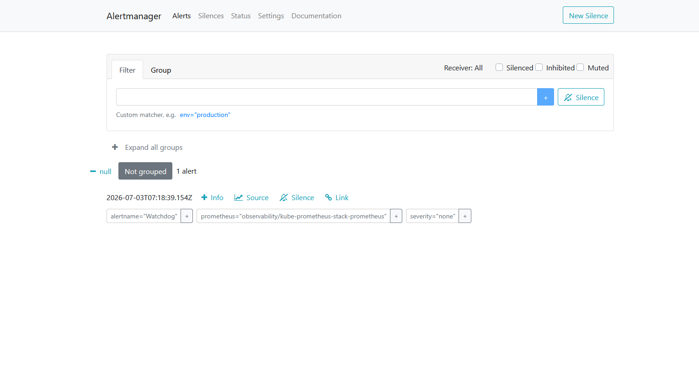
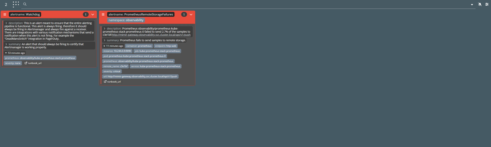

# Karma

**In one line:** a clean, groupable dashboard for your Prometheus
**Alertmanager** - every firing, silenced, and inhibited alert in a single view.

> Chart: `helm/karma` (first-party, appVersion v0.131) ·
> config: [`helm/karma/values.yaml`](../../helm/karma/values.yaml) ·
> UI: `http://localhost:8081`

> [!NOTE]
> Karma is deployed only in the alternate **Prometheus metrics-collection mode**,
> an opt-in for specific testing scenarios (see
> [metrics-modes.md](../metrics-modes.md)). In the default setup it's skipped:
> Grafana Alerting (via the Mimir datasource, whose `manageAlerts` is on) plus
> the Alertmanager datasource already cover "what's firing right now," so a
> separate read-only Alertmanager dashboard isn't needed.

## What it is

[**Karma**](https://github.com/prymitive/karma) is a lightweight,
**read-only web UI for Alertmanager**. Alertmanager ships its own UI, but it's
bare-bones; Karma gives you a much richer view of the same data: alerts grouped
by label, colour-coded by severity, with fast filtering, multi-Alertmanager
aggregation, and silence management from the browser.


*Alertmanager's built-in UI at `http://localhost:9093` - functional but plain, showing the always-on `Watchdog` alert. Karma renders this same data with grouping, severity colours, and filtering.*

Crucially, Karma is a **consumer of Alertmanager, not a receiver.** It *polls
Alertmanager's HTTP API* on an interval and renders whatever it finds.
Alertmanager never pushes to it - there is no "send alerts to Karma" step.

## Where it fits among the others

Prometheus (from the [kube-prometheus-stack](./kube-prometheus-stack.md))
evaluates alerting rules and fires alerts into **Alertmanager**, which
deduplicates, groups, silences, and routes them. Karma sits one step further
out: it's the **human-facing window** onto Alertmanager's current state.

```
  Prometheus  ──fires alerts──▶  Alertmanager  ──API (polled)──▶  Karma  ──▶  you
  (rules)                        (route/group/silence)            (dashboard)
```

Where Grafana answers "what are my metrics/logs/traces doing?", Karma answers
the narrower, urgent question: **"what is firing right now, and what have we
already silenced?"**

## How we use it in this demo

Karma is deployed in the Prometheus metrics-collection mode
(`make up METRICS_MODE=prometheus`; target `make karma`, part of `stack`'s
prerequisites in that mode) into the `observability` namespace, exposed on
`http://localhost:8081`. See [metrics-modes.md](../metrics-modes.md).

- **Points at the in-cluster Alertmanager.**
  [`helm/karma/values.yaml`](../../helm/karma/values.yaml) configures one
  Alertmanager server -
  `http://kube-prometheus-stack-alertmanager.observability.svc.cluster.local:9093`
  - with `proxy: true`, so Karma's pod reaches Alertmanager on the browser's
  behalf (the browser can't resolve in-cluster Service DNS).
- **Sees *all* alerts by default.** Karma only shows what Alertmanager holds, so
  this demo configures a single **catch-all route** in
  [`helm/kube-prometheus-stack/values.yaml`](../../helm/kube-prometheus-stack/values.yaml).
  The stock kube-prometheus-stack config funnels everything into a `null`
  receiver and carves out a separate Watchdog route; we collapse that into one
  `catch-all` receiver so **no alert is dropped or filtered before it reaches
  Alertmanager's store** - and therefore Karma. Every severity, every
  namespace, including the always-firing `Watchdog` heartbeat.
- **Stateless.** No persistence - it re-derives everything from Alertmanager on
  each poll (default every 60s).

## Try it


*The same alerts in Karma at `http://localhost:8081` - each grouped into a colour-coded card with its full labels, description, summary, and runbook link laid out for fast triage. Compare with Alertmanager's plainer list above.*

- Open `http://localhost:8081`. Out of the box you'll see at least the
  **`Watchdog`** alert (kube-prometheus-stack's always-on heartbeat) and any
  infrastructure alerts currently firing.
- Group and filter: use the search bar to filter by label
  (e.g. `alertname=Watchdog`, `severity=warning`, `namespace=observability`).
- Create a **silence** from a Karma alert, then watch it move into the silenced
  view - and confirm it also appears in Alertmanager at
  `http://localhost:9093`.

## Why it matters

Alerting is only useful if a human can quickly make sense of it. During an
incident, dozens of related alerts fire at once; Alertmanager's own UI makes
that hard to scan. Karma's grouping and filtering turn a wall of alerts into a
readable picture of **what's broken and what's already handled** - the
triage-friendly front door to your alerting pipeline.

## Learn more

- [Karma on GitHub](https://github.com/prymitive/karma)
- [Alertmanager docs](https://prometheus.io/docs/alerting/latest/alertmanager/)
- [Kube-Prometheus-Stack guide](./kube-prometheus-stack.md) - where the alerts come from
