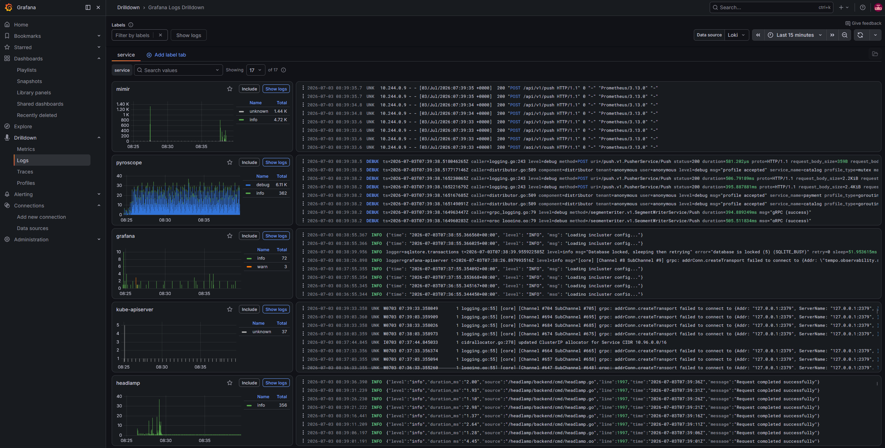

# Loki

**In one line:** log aggregation that's cheap because it indexes **labels, not
the log text** - "like Prometheus, but for logs."

> Chart: `grafana/loki` (v7.3.0, SingleBinary mode) ·
> config: [`helm/loki/values.yaml`](../../helm/loki/values.yaml) ·
> queried through Grafana at `http://localhost:3000`

## What it is

**Grafana Loki** is a log database designed to be inexpensive to run. Most log
systems build a full-text index of every log line (powerful, but storage-hungry
and costly). Loki takes a different bet: it **only indexes a small set of
labels** (like `namespace`, `pod`, `app`) and stores the raw log content
compressed in object storage. You narrow down by labels first, then grep the
matching streams.

It uses the same label model as Prometheus, so if you know how to select metrics
by label, you already know how to select logs. Queries are written in **LogQL**,
a log-flavored cousin of PromQL.

## Key ideas

- **Streams and labels.** A "stream" is a unique set of labels; log lines are
  appended to streams. You query like `{namespace="otel-demo", app="frontend"}`.
- **Index cheap, store cheap.** Small label index + compressed chunks in object
  storage = a fraction of the cost of full-text logging.
- **LogQL.** Filter (`|= "error"`), parse (`| json`), and even derive metrics
  from logs (`count_over_time(...)`).
- **Ruler.** Loki can evaluate LogQL alerting rules on a schedule and fire the
  results into Alertmanager - "alert when the error-log rate crosses a
  threshold," the log-native counterpart to a Prometheus alert.

## How we use it in this demo

Loki is the **store for logs.** Applications and pods just write to **stdout**;
[Alloy](./alloy.md) tails those logs and pushes them to Loki. Nothing in the app
talks to Loki directly.

- Runs in **SingleBinary (monolithic) mode** with **filesystem** storage - the
  whole thing is one pod, ideal for a laptop cluster.
- Grafana's Loki datasource has a **derived field** on `trace_id`, so a log line
  from the demo app becomes a **clickable link to its trace** in
  [Tempo](./tempo.md) - that's log↔trace correlation in action.
- The **ruler is enabled** (`helm/loki/values.yaml` → `rulerConfig`) and fires
  into the same Alertmanager kube-prometheus-stack runs. The chart's rules
  sidecar syncs any ConfigMap labelled `loki_rule` into the ruler; the demo ships
  a set of LogQL alerts in
  [`apps/otel-demo/k8s/loki-rules.yaml`](../../apps/otel-demo/k8s/loki-rules.yaml)
  (e.g. "alert when the otel-demo error-log rate is high"). Turn up *simulated
  errors* in the demo UI to watch them fire - they show up in **Grafana
  Alerting** next to the metric-based alerts from Mimir's ruler.

## Try it

- In Grafana, **Explore → Loki** and run `{namespace="otel-demo"}` to see the
  demo app's logs.
- Filter with LogQL: `{namespace="otel-demo"} |= "order placed"`.
- Click the `trace_id` on any line to jump straight to the matching trace.

*Logs Drilldown over the Loki datasource - every service's log stream, grouped by label with a volume sparkline, ready to drill into.*

## Why it matters

Logs are the ground truth of "what did the code actually say happened." Loki lets
you keep all of them affordably, and - because it shares Prometheus's label model
and links out to traces - it slots naturally beside your metrics and traces
instead of living in a separate, expensive silo.

## Learn more

- [Grafana Loki docs](https://grafana.com/docs/loki/latest/)
- [LogQL reference](https://grafana.com/docs/loki/latest/query/)
