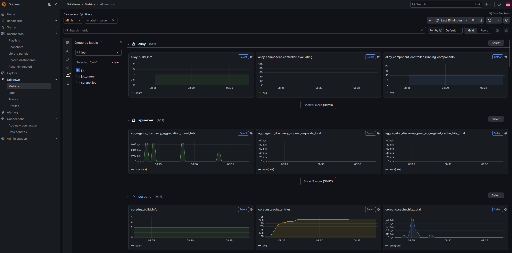

# Mimir

**In one line:** the long-term, horizontally scalable home for your Prometheus
metrics - think "Prometheus storage that never fills up."

> Chart: `grafana/mimir-distributed` (v6.1.0) ·
> config: [`helm/mimir/values.yaml`](../../helm/mimir/values.yaml) ·
> queried through Grafana at `http://localhost:3000`

## What it is

A single Prometheus keeps a limited window of metrics on local disk and doesn't
scale past one machine. **Grafana Mimir** solves both problems: it's a
distributed time-series database that stores Prometheus-compatible metrics in
cheap **object storage** (S3, GCS, MinIO…) and can ingest and query at very
large scale.

Crucially, it speaks the **same PromQL and remote-write protocol** as
Prometheus, so it's a drop-in long-term backend - Prometheus scrapes and
remote-writes to Mimir, Grafana queries Mimir with the exact PromQL you already
know.

## Key ideas

- **Remote-write in, PromQL out.** Prometheus pushes samples to Mimir's
  `/api/v1/push`; Grafana reads them back via a Prometheus-compatible query API.
- **Object storage.** Metric blocks live in an object store, so retention is
  bounded by bucket size and cost, not by a node's disk.
- **Microservices architecture.** Mimir splits into components - distributor,
  ingester, querier, query-frontend, compactor, store-gateway - that scale
  independently. This is what lets it grow, but it's also why Mimir is the
  heaviest tool in this demo.

## How we use it in this demo

Mimir is the **long-term store for all metrics.** [Alloy](./alloy.md) does the
scraping and remote-writes everything to Mimir, and Grafana's default metrics
datasource points at Mimir.

**Exemplar storage is enabled** (`max_global_exemplars_per_user`), which is off
by default in Mimir. An exemplar is a trace ID attached to a single sample, so a
spike on a graph links straight to one request that caused it - the first hop of
metrics → traces → profiles. A zero here would accept exemplars and silently
discard them; see [correlation.md](../correlation.md).

Mimir's **ruler** is enabled: Alloy syncs `PrometheusRule` objects into it, the
ruler evaluates them, and fires alerts to the kube-prometheus-stack Alertmanager
(`structuredConfig.ruler.alertmanager_url` is pointed there explicitly, since
Mimir's own bundled Alertmanager component stays disabled - there's only one
Alertmanager in this demo). See
[architecture.md](../architecture.md#metrics-collection--alerting).

There's no official "single binary" Mimir chart, so we run the microservices
chart at its **minimum viable scale** - one replica per component, no zone
awareness, no Kafka, caches off, with bundled **MinIO** as the object store.
That's still ~9-10 pods (vs. the ~17 the defaults render). The full reasoning
is in [architecture.md](../architecture.md#mimir-the-exception).

## Try it

- In Grafana, **Explore → Mimir** and query `demo_orders_total` or
  `http_server_request_duration_seconds_count` from the demo app.
- Query `up` to see every scrape target Alloy remote-writes into Mimir.
- Mimir also stores **span metrics** generated by Tempo, powering
  service-graph and RED panels.

*Metrics Drilldown pointed at the Mimir datasource - the remote-written metrics from every component, grouped by `job` and browsable without writing PromQL.*

## Why it matters

Metrics are only useful if you can keep them long enough to spot trends and
compare week-over-week. Mimir gives you Prometheus's query language with
cloud-scale storage and retention behind it - without changing how you scrape or
query.

## Learn more

- [Grafana Mimir docs](https://grafana.com/docs/mimir/latest/)
- [mimir-distributed chart](https://github.com/grafana/mimir/tree/main/operations/helm/charts/mimir-distributed)
