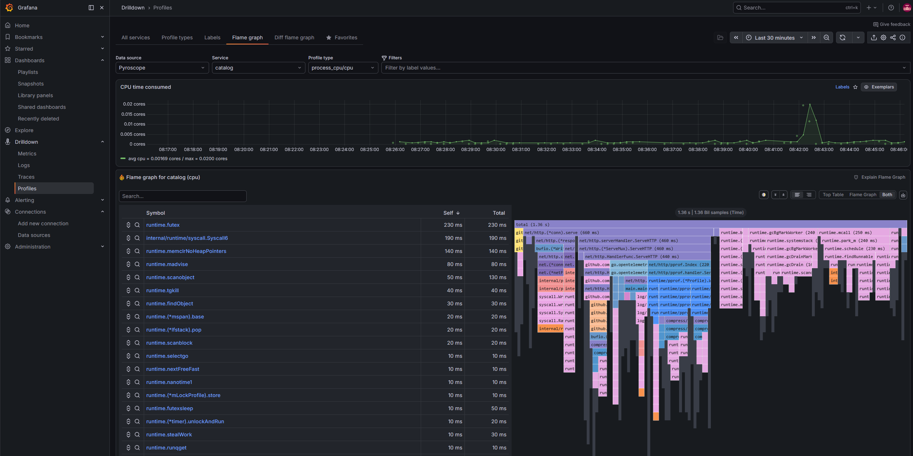

# Pyroscope

**In one line:** continuous profiling - it answers "**where is my CPU/memory
actually going?**" with flame graphs you can scroll back through time.

> Chart: `grafana/pyroscope` (v2.1.0, monolithic `all` target) ·
> config: [`helm/pyroscope/values.yaml`](../../helm/pyroscope/values.yaml) ·
> queried through Grafana at `http://localhost:3000`

## What it is

A **profile** is a breakdown of where a program spends a resource - which
functions burned the CPU, or held the most memory. Traditionally you'd capture a
profile by hand when something was already on fire. **Grafana Pyroscope** does it
**continuously**: it collects lightweight profiles from your services all the
time and stores them, so you can open a **flame graph** for *any* point in the
past, not just when you remembered to press record.

A flame graph shows the call stack as nested bars - the **wider** a bar, the more
of the resource that function accounts for. The widest bar at the bottom is your
hot path.

## Key ideas

- **Continuous & always-on.** Profiles are sampled at low overhead around the
  clock, so post-mortem "what was it doing at 2am?" is answerable.
- **Time-travel flame graphs.** Pick any window and see the aggregated stacks
  for it; diff two windows to see what changed.
- **Language profilers feed it.** It ingests profiles from runtimes - for Go,
  the built-in `net/http/pprof` endpoints are scraped directly.

## How we use it in this demo

Pyroscope is the **store for profiles.** The demo app exposes Go's standard
`/debug/pprof` endpoints and opts in with a pod annotation
(`pyroscope.io/scrape: "true"`); [Alloy](./alloy.md) scrapes those endpoints and
ships the profiles to Pyroscope.

- Runs in **monolithic** mode (the chart's `all` target as one StatefulSet) with
  **filesystem** storage.
- The demo's `payment` service deliberately runs a tight hashing loop
  (`burnCPU`) so there's an **obvious hot path** to spot in the flame graph.

## Try it

- In Grafana, **Explore → Pyroscope** and select the `payment` service.
- Look at the CPU flame graph - the wide `burnCPU` / hashing frame is the
  intentional hot spot.
- Narrow the time range to a burst of order traffic and watch the profile change.

*Profiles Drilldown over the Pyroscope datasource - CPU-time-over-time on top, the flame graph and top-functions table below. Wider frames = more CPU.*

## Why it matters

Metrics, logs, and traces tell you *that* a service is slow or hungry and *which*
one - profiling tells you the **exact function** to fix. It closes the last mile
from "checkout latency is up" to "this specific loop is the cost," making it the
fourth signal that turns observability into concrete code changes.

## Learn more

- [Grafana Pyroscope docs](https://grafana.com/docs/pyroscope/latest/)
- [Flame graphs explained](https://www.brendangregg.com/flamegraphs.html)
