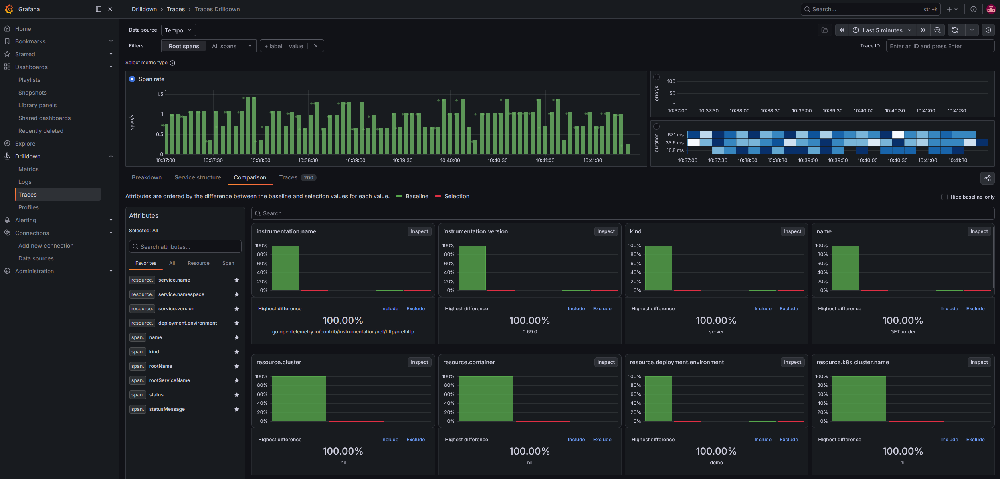

# Tempo

**In one line:** a distributed tracing backend that's cheap enough to keep
**every** trace, because it only needs object storage — no big index.

> Chart: `grafana-community/tempo` (v2.2.3, single binary mode) ·
> config: [`helm/tempo/values.yaml`](../../helm/tempo/values.yaml) ·
> queried through Grafana at `http://localhost:3000`

## What it is

A **trace** follows a single request across every service it touches, breaking it
into timed **spans** (`frontend → checkout → payment` becomes one connected
waterfall). Tracing is how you answer "*why was this one request slow?*" and
"*where did it fail in the chain?*".

**Grafana Tempo** stores those traces. Its defining design choice: it needs
**only object storage** and **no expensive index**. You find a trace by its
**trace ID** (usually handed to you from a log line or an exemplar), and Tempo
retrieves it. That makes it dramatically cheaper than index-heavy tracing
systems, so you can sample 100% instead of throwing traces away.

## Key ideas

- **Spans and trace IDs.** Every hop is a span; they share a trace ID, so the
  full request reassembles into one timeline.
- **OTLP native.** Tempo ingests **OpenTelemetry (OTLP)** and other common trace
  protocols, so any OTel-instrumented app can send to it.
- **Correlation over search.** The intended workflow is to *arrive* at a trace
  from a metric exemplar or a log's `trace_id`, rather than full-text searching —
  though it supports **TraceQL** for querying too.
- **Metrics from traces.** Tempo can generate **span metrics** and
  **service-graph** data, written to a metrics store like [Mimir](./mimir.md).

## How we use it in this demo

Tempo is the **store for traces.** The demo app exports spans over **OTLP/gRPC**
to [Alloy](./alloy.md), which forwards them to Tempo.

- Runs in **single-binary (monolithic) mode** with **filesystem** storage — one
  pod, laptop-friendly.
- Span metrics / service-graph data flow back to Mimir, powering RED dashboards
  and the service graph.
- Grafana's Tempo datasource is pre-wired with **trace-to-logs** and
  **trace-to-metrics** links, so from a span you can jump to its logs in
  [Loki](./loki.md) or its metrics in Mimir.

## Try it

- In Grafana, **Explore → Tempo** → search `service.name=frontend` and open a
  trace spanning `frontend → checkout → payment / catalog`.
- Open the **Service Graph** tab to see the topology and RED stats between
  services.
- From a span, follow the pre-wired links to the exact logs and metrics for that
  request.

*Traces Drilldown over the Tempo datasource — span rate, a duration heatmap, and per-attribute breakdowns of the demo app's traces.*

Because the Tempo datasource is wired with **trace-to-logs**, opening a span and
clicking *Logs for this span* pivots straight to the matching log line in Loki —
one request, both signals, side by side:

*A `frontend → checkout → payment / catalog` trace (left) linked to its `order placed` log line (right) via the shared `trace_id`.*

## Why it matters

In a microservices world, a metric tells you *that* latency went up but not
*which hop* caused it. Traces pinpoint the culprit. Because Tempo is so cheap to
run, you can keep every trace and always have the one you need — then pivot to
logs and metrics without leaving Grafana.

## Learn more

- [Grafana Tempo docs](https://grafana.com/docs/tempo/latest/)
- [TraceQL reference](https://grafana.com/docs/tempo/latest/traceql/)
